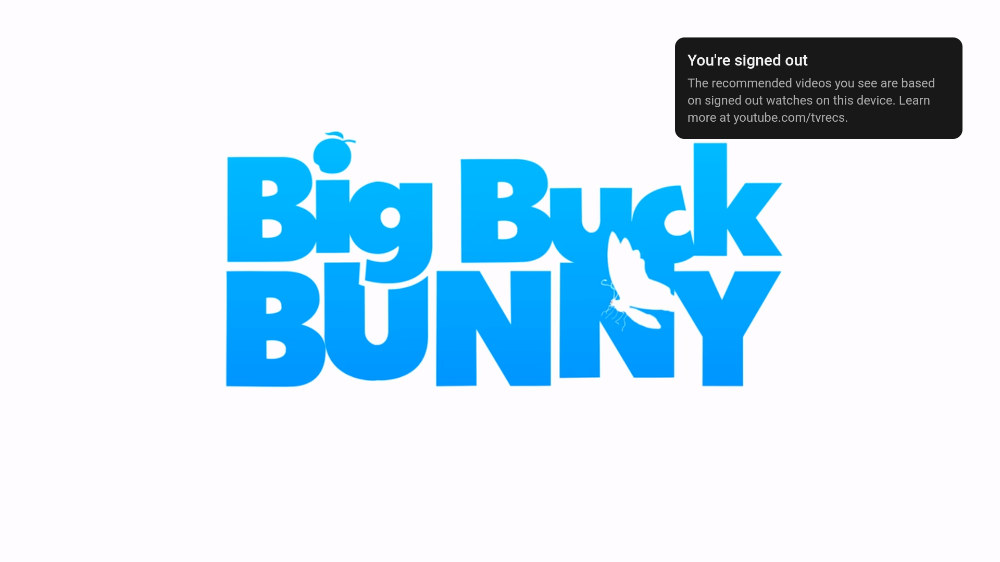
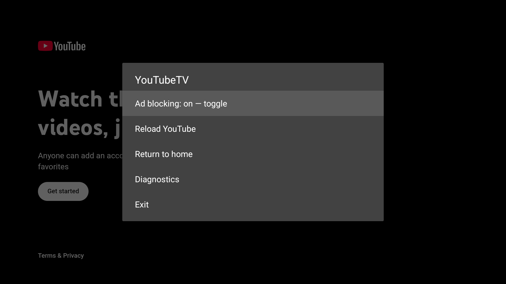

# Android port validation

## Zoom, background playback, and touch lock — 2026-10-29 (0.3.0 / code 3)

All **12 controlled tests passed** on Android 14 ARM64 TV (1920×1080) and Android
15 ARM64 phone resized to **2176×1812 landscape** to exercise a Fold-shaped inner
display. [TV output](evidence/v030-tv.txt) · [Fold-shaped emulator output](evidence/v030-fold.txt).
Tests cover zoom fit/fill and viewport bounds, preference reapplication after reload,
Android fit overriding desktop CSS, menu toggles, touch lock with hold-to-unlock,
remote input while locked, and every previous gesture/filter/controller regression.
A generated H.264/AAC fixture verified advancing video behind Home and for four
seconds with the screen off, notification Pause, pause-on-leave when disabled, and
foreground-service cleanup on exit.

**Live YouTube playback also passed** on the Fold-shaped emulator at 1920×1080:
clock advanced from 2.16 to 7.38 seconds, remote pause/resume worked, then playback
continued behind Home and with the screen off (five seconds each).
[Live test](evidence/v030-live.txt) · [Telemetry](evidence/v030-live-report.json).
This session counted four blocked requests and zero interception errors.

Universal debug/test APK builds, Android lint (0 errors, 22 warnings), and `npm test`
passed. No physical Samsung Fold or Chromecast was connected. Long screen-off
sessions, Samsung battery policies, folding between displays on real hardware, and
playback recovery after process death are not established by these short tests.

## Touch navigation update — 2026-10-28 (0.2.0)

All **8 controlled instrumentation tests passed on both** the Android 14 ARM64
TV emulator (1920×1080) and an Android 15 ARM64 Pixel 5 emulator in landscape.
See [TV output](evidence/gesture-tv.txt) and [phone output](evidence/gesture-phone.txt).
Coverage includes four swipe directions, tap/select, double-tap/back, hold/settings,
no duplicate DOM clicks, cancellation/multitouch, switching from touch to remote,
ordinary Google consent touch, remote/gamepad buttons, captions/aspect shortcuts,
stick repeat/disconnect, JNI filtering, fetch/XHR pruning, and blocker toggling.
The phone's first-use Android immersive-mode hint must be dismissed before testing.

The debug and instrumentation APKs built, Android lint passed, and `npm test`
passed. A live phone playback/pause-resume run succeeded earlier in this session;
a repeat timed out before playback started. The current TV live check encountered
YouTube's account/bot-confirmation screen; saved accounts were left untouched.
These network-dependent results do not establish reliable playback on every session
or physical Chromecast compatibility. The historical live evidence below is from
the previous version, not a new successful TV playback run.

Tested on 2026-10-27 on an Apple-silicon Mac using an Android 14 (API 34)
Android TV ARM64 emulator, `tv_1080p` profile (1920×1080 display), with the image's
bundled Google WebView 113.0.5672.136. The emulator used SwiftShader rendering.
No Google account was signed in.

## Results

- Universal debug APK and unsigned release APK built for ARM64, ARMv7, and
  x86_64. The universal debug APK is approximately 26 MB.
- Six instrumented tests passed, both through Gradle and via direct `adb am
  instrument` on the final universal debug APK. See [test output](evidence/instrumentation.txt).
- Real `youtube.com/tv` loaded the leanback UI and played the public Big Buck
  Bunny video `aqz-KE-bpKQ` at **1280×720**. Its clock advanced from 2.12 to
  7.17 seconds over a five-second interval. Remote play/pause paused and resumed
  the video. See [telemetry](evidence/live-report.json).
- The live session counted **5 blocked network requests, 0 interception
  errors**. This is evidence of network interception, not a claim that every
  kind of YouTube ad has been eliminated.
- Controlled WebView fixtures verified early navigator spoofing, fetch/XHR
  removal of `playerAds`/`adPlacements`/`adSlots`, preservation of content video
  metadata and streaming data, network blocking, and disabling/re-enabling the
  blocker. JNI checks preserved ordinary media and Google sign-in sources.
- Remote D-pad/select and gamepad B/X/LT delivery passed; stick auto-repeat
  stopped on controller disconnect. The native settings menu was also opened
  and visually inspected on the emulator.
- `npm test` passed (4 shared Rust tests plus the desktop gamepad suite).
  `cargo clippy --locked --manifest-path android/blocker/Cargo.toml -- -D warnings`
  passed. Android lint completed with 0 errors and 19 warnings, including newer
  dependency versions, untranslated strings, intentional landscape orientation,
  and conservative feature/ABI detection warnings.

## Remaining device validation

Physical Chromecast hardware, account sign-in/session retention, Bluetooth
controller models, 4K/HDR, and long sessions with mid-roll/post-roll ads have not
been verified. The emulator does not establish those capabilities. The port
currently ships bundled filters rather than the desktop filter updater.

## Host tooling notes

The newest installed Mac ADB binary crashed with
`libunwind: stepWithCompactEncoding - invalid compact unwind encoding`.
Using Google's platform-tools 35.0.2 ADB resolved the connection loss. The
emulator image's missing optional `devices.xml` warning did not prevent creation
or startup. The live test posts bounded main-thread operations because waiting
for ActivityScenario's UI-idle synchronization can hang during video playback.

See [README.md](README.md#emulator-tests) for build and reproduction commands.
